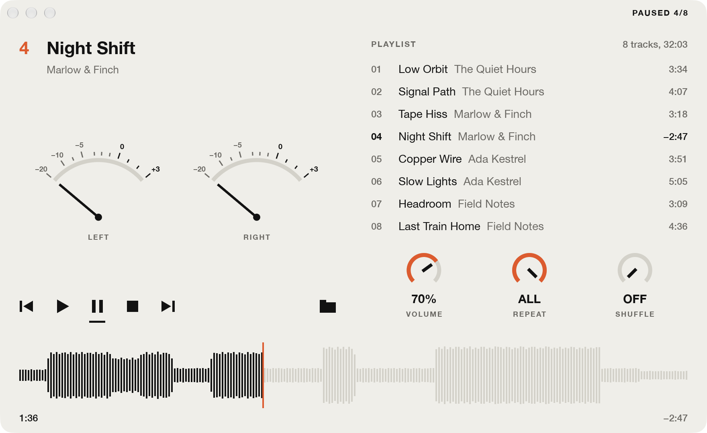

# MP3deck



MP3deck is a small, minimal MP3 player for macOS, styled after the [fm1-sampler](https://github.com/ferluht/fm1-sampler) deck. Drop MP3s, MP4s, MKVs or folders on the window and press Space.

MP4 and MKV files play their audio only. MP3 and AAC decode in the app. Anything else, such as Opus in MKV, needs `ffmpeg` (`brew install ffmpeg`).

MP3deck only reads your files. It never changes or deletes them.

## Install

Requirements:

- Apple Silicon Mac (M1 or later). There is no Intel build.
- macOS 13 Ventura or later.
- Optional: `ffmpeg` from Homebrew, for formats beyond MP3 and AAC.

Steps:

1. Download `MP3deck-<version>-arm64.zip` from [GitHub Releases](https://github.com/pfinette/mp3deck/releases).
2. Unzip it and move `MP3deck.app` to `/Applications`.
3. Open it once as described below.

The app is not signed with an Apple Developer ID or notarized, so macOS blocks it the first time. On macOS 15 Sequoia and later, right-click → Open no longer bypasses this. Use one of these instead:

- **System Settings.** Open the app once and dismiss the warning. Go to System Settings → Privacy & Security, scroll to the Security section, and click **Open Anyway** next to MP3deck. Confirm with your password.
- **Terminal.** Remove the quarantine flag that macOS added when you downloaded the zip:

  ```sh
  xattr -dr com.apple.quarantine /Applications/MP3deck.app
  ```

Either step is needed only once. Building from source avoids it entirely.

## Use

| Input | Action |
|---|---|
| Drop files or folders | Add to the playlist. Plays at once when the deck was stopped |
| ⌘O or the folder icon | Choose files |
| Space | Play or pause. When stopped, plays the selected track |
| ⌘← / ⌘→ | Previous / next. Previous restarts the track first after 3 s |
| ↑ / ↓, ⏎ | Select a track, play it |
| ⌫ | Remove the selected track from the playlist |
| Double-click a track | Play it |
| Right-click a track | Play, Show in Finder, Remove from Playlist, Clear Playlist |
| Right-click the track list | Load Tracks, Clear Playlist |
| Click or drag the waveform | Jump |

- The waveform shows the whole track. Ink marks what has played, grey what's to come, and the orange line the current position. Long files fill it in as they are read.
- Two VU dials show the left and right level, read before the volume knob.
- VOLUME is a knob; drag up or down. REPEAT and SHUFFLE are knobs too. Click for the next setting, or drag.
- REPEAT is OFF, ONE or ALL. SHUFFLE plays the rest of the list at random, starting from the current track.
- The window follows the system's light or dark mode.
- The playlist, volume, repeat and shuffle persist between launches. So does the place in the current track. The deck opens paused there, and Space carries on.
- Playback continues when the window is covered or minimised.

## Build from source

Needs Rust (`rustup`) and the Xcode command-line tools (`xcode-select --install`).

```sh
git clone https://github.com/pfinette/mp3deck.git
cd mp3deck
./bundle.sh            # builds target/MP3deck.app
./bundle.sh --install  # also copies it to /Applications/Werkzeuge
```

`bundle.sh` signs the app ad hoc, which is enough to run a copy you built yourself. `cargo test` runs the playlist, meter and decode tests. The Opus-in-MKV test needs `ffmpeg`.

## Layout

| Path | Contents |
|---|---|
| `src/lib.rs` | Tracks, metadata, playlist order, shuffle and repeat |
| `src/audio.rs` | Output device, decoders, level meter, transport |
| `src/ffmpeg.rs` | Decoding through an external `ffmpeg` process |
| `src/wave.rs` | Waveform analysis |
| `src/main.rs` | egui app |
| `scripts/icon.py` | Draws `assets/icon.png` |
| `bundle.sh` | Builds and signs the .app |
| `about.toml`, `about.hbs` | `cargo about` config that generates `THIRD_PARTY_LICENSES` |

## License

MP3deck is under the [MIT License](LICENSE). It is provided AS IS, without warranty of any kind. The author accepts no liability for any damage from using it.

### Notice for binaries

Release binaries include [Symphonia](https://github.com/pdeljanov/Symphonia), which decodes MP3 and AAC. Symphonia is licensed under the Mozilla Public License 2.0 and is used unmodified. Its source is available from its repository and from crates.io.

MP3deck does not include ffmpeg. It runs a copy you installed yourself.

[THIRD_PARTY_LICENSES](THIRD_PARTY_LICENSES) lists every bundled dependency with its full license text. A copy ships inside the app at `MP3deck.app/Contents/Resources/`. To regenerate it after changing dependencies:

```sh
cargo install cargo-about --locked --features cli
cargo about generate about.hbs -o THIRD_PARTY_LICENSES
```
